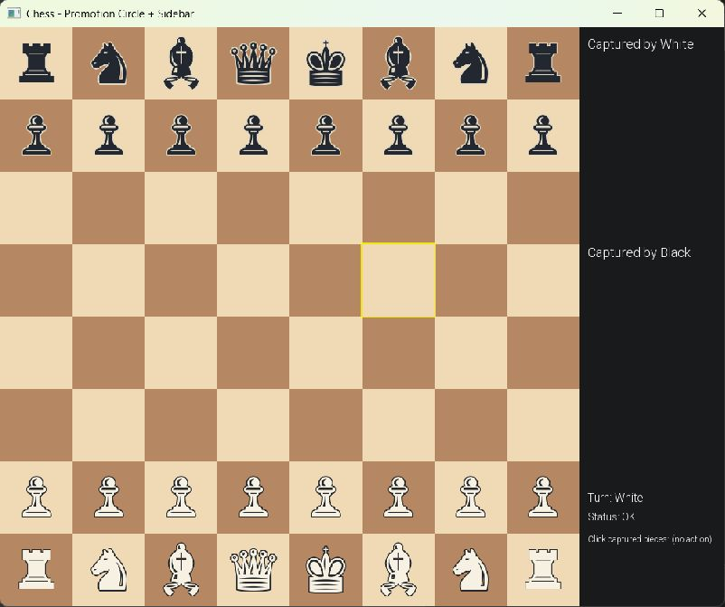
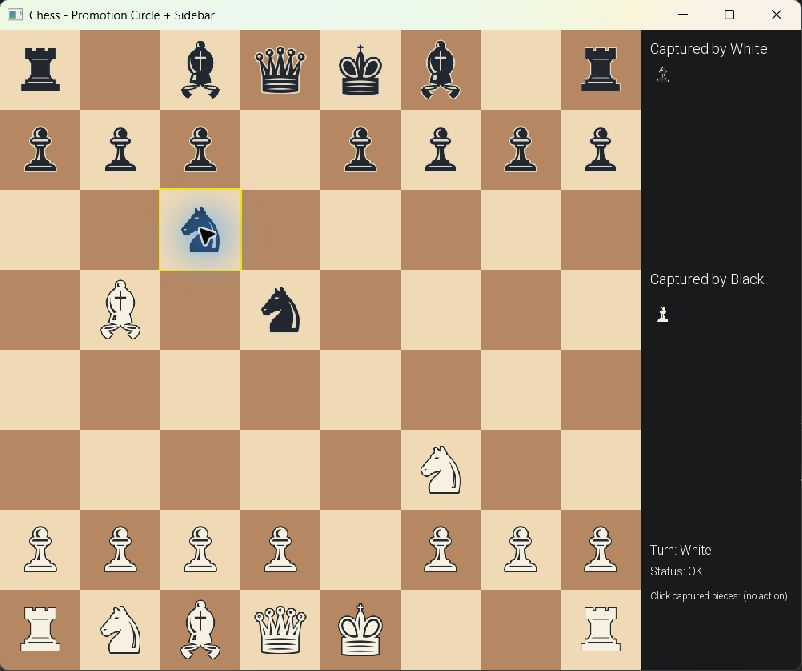
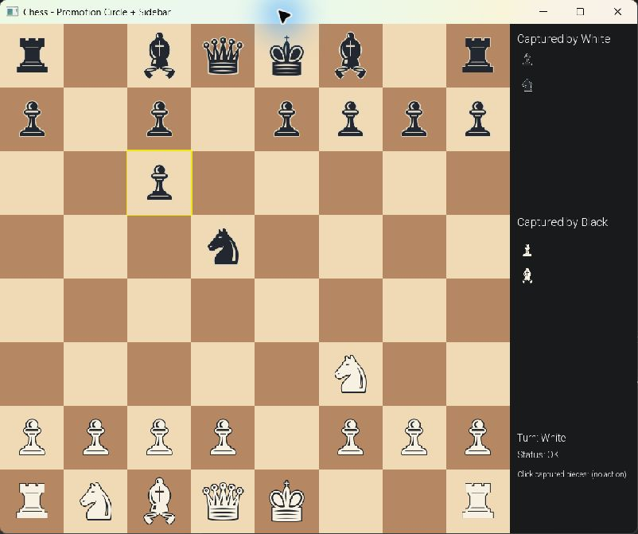

# Chess Game

A local two-player chess project built with **C++17** and **SFML 2.6.2**, created to practice programming fundamentals, board representation, move validation, and graphical event handling.

## Gameplay Demo

https://github.com/user-attachments/assets/17577254-d41d-449c-b0fe-2cc59545b17b

[Open the full gameplay video](Videos/demo.mp4)

## Project Preview

### Starting Board



### Gameplay



### Captured Pieces



The demo was recorded from the application launched through Visual Studio. It shows pawn and knight moves, captures, bishop movement, and turn changes.

## Features

- Local White-versus-Black play on an 8×8 board.
- A 1000×800 window with an 800×800 board and a captured-piece sidebar.
- Mouse drag-and-drop movement.
- Highlighted selection, available destinations, and hovered squares.
- Movement generation for pawns, rooks, knights, bishops, queens, and kings.
- Filtering of moves that would leave the moving player's king in check.
- Pawn promotion selection with queen, rook, bishop, and knight options.
- Captured-piece trays for both players.
- Turn and status indicators.
- Console move messages using square names such as `e2` and `e4`.
- Feedback for invalid moves and cancelled drops.
- PNG piece textures, with fallback drawing when an image is unavailable.

This is an educational chess implementation rather than a complete tournament-rules engine. See the limitations below.

## Requirements

- **Windows**, because the source uses `windows.h` to locate the executable folder.
- **Visual Studio 2022** with the **Desktop development with C++** workload.
- **SFML 2.6.2** libraries compatible with the Visual Studio compiler and x64 platform.
- The supplied `pieces/` images and `arial.ttf` font.

The source uses the SFML 2 API and needs changes to build with SFML 3.

## Build and Run in Visual Studio

1. Open **ChessProject.vcxproj** in Visual Studio.
2. Select **Debug** and **x64**. This is the configuration used for the captured demo.
3. The project expects SFML at `C:\SFML-2.6.2`. If your installation differs, update the include directory, library directory, and `CopySFML` target in the project file.
4. Confirm the linked Debug libraries are `sfml-graphics-d.lib`, `sfml-window-d.lib`, and `sfml-system-d.lib`. Release builds use the corresponding libraries without `-d`.
5. Keep the working directory set to the project directory so `pieces/` and `arial.ttf` can be found. The provided project includes this setting.
6. Press **Ctrl + F5** to build and run without debugging.

The project copies SFML runtime DLLs from the configured SFML `bin` directory into the output directory after building. It uses C++17 and defines `NOMINMAX` to prevent Windows macros from interfering with standard-library functions.

### Optional MinGW Build

With an SFML build matching your MinGW compiler, adjust the paths and run:

```powershell
g++ -std=c++17 -DNOMINMAX chess.cpp -o chess.exe -IC:/SFML-2.6.2/include -LC:/SFML-2.6.2/lib -lsfml-graphics -lsfml-window -lsfml-system
.\chess.exe
```

Visual Studio and MinGW require compatible SFML distributions; do not mix their library builds. Keep the required runtime DLLs accessible to the executable.

## Controls

| Input | Action |
| --- | --- |
| Hold the left mouse button on your piece | Select it and begin dragging |
| Release over a highlighted destination | Attempt the move |
| Hover over a square | Show its outline |
| Escape while dragging | Cancel the drag |
| Drop a piece on the sidebar or outside the board | Cancel the move |
| Click a promotion option | Choose the pawn's replacement |
| Window close button | Exit |

White moves first. Players take turns on the same computer. Captured-piece trays are displays; clicking them does not return pieces to the board. To begin another game, close and relaunch the application.

## Piece Images and Font

The `pieces/` folder contains twelve transparent PNGs:

```text
White: wp.png  wr.png  wn.png  wb.png  wq.png  wk.png
Black: bp.png  br.png  bn.png  bb.png  bq.png  bk.png
```

The first letter identifies the color. The second identifies the piece: pawn, rook, knight, bishop, queen, or king.

These local demo images were rendered from the system's chess-symbol font. They can be replaced with another piece set using the same filenames. The supplied font is Roboto Light, copied under the `arial.ttf` filename expected by this source.

The image loader checks the working directory's `pieces/` folder, locations relative to the executable, and an additional relative assets location. Keeping `pieces/` in the project working directory is the simplest arrangement.

## How the Program Works

The board is a nested `std::array` containing eight rows of eight characters. Uppercase characters represent White, lowercase characters represent Black, and `.` represents an empty square. Piece-specific routines generate candidate destinations, stopping sliding pieces at occupied squares. Each candidate is simulated on a board copy and rejected if it leaves the moving side's king in check. Accepted moves update the board and captured-piece lists, then switch turns. A pawn reaching the last rank opens a promotion menu before the turn changes. SFML handles mouse events, sprite drawing, highlights, text, and rendering.

## Concepts Demonstrated

- Two-dimensional arrays and character-based board representation.
- Functions, conditionals, loops, and enumerations.
- Vectors for generated moves and captured pieces.
- Maps for textures and asset availability.
- Board copying and simulation for move validation.
- Event-driven mouse and keyboard input.
- Texture loading, sprites, shapes, and text in SFML.
- Windows executable-path lookup for asset discovery.

## Current Limitations

- Castling and en passant are not implemented.
- Repetition, the fifty-move rule, and insufficient-material draws are not tracked.
- There is no AI opponent, networking, undo, saved-game loading, or in-game restart.
- Check, checkmate, and stalemate handling is present, but check highlighting and checkmate winner labels have known inconsistencies. Terminal-state enforcement and promotion edge cases need further testing.
- The promotion menu is placed near the destination square and can extend outside the visible board at its edges.

## Repository Structure

```text
Chess-Game/
├── chess.cpp
├── ChessProject.vcxproj
├── README.md
├── .gitignore
├── arial.ttf
├── pieces/
│   ├── wp.png ... wk.png
│   └── bp.png ... bk.png
├── ScreenShots/
│   ├── interface.png
│   ├── gameplay.png
│   └── captures.png
└── Videos/
    ├── demo.mp4
    └── preview.gif
```

## Validation and Preparation

The working copy was built and launched through **Visual Studio 2022, Debug x64**, using **SFML 2.6.2**. Interactive checks exercised pawn and knight movement, captures for both sides, bishop movement, and blocking check. The screenshots and video show actual execution; they are not mockups.

The originally supplied `chess.cpp` had every line commented out. This working copy removes those outer comment markers and keeps a fallback drag texture alive for the window's lifetime. Local image assets, a font, and a Visual Studio project were added for running and capturing the demonstration. The original source files were left intact.
